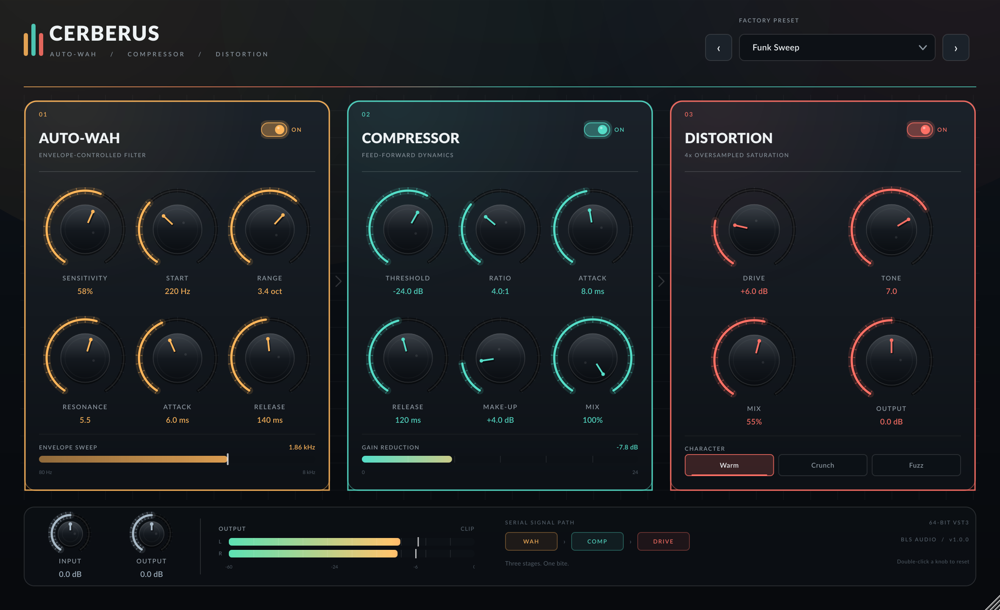

# Cerberus

**Cerberus** is a three-stage audio effect plugin built with JUCE 8. It runs an
**auto-wah → compressor → distortion** signal path with independent module
bypasses, factory presets, live envelope/gain-reduction meters, and a resizable
custom interface.



## Signal path

| Stage | Processing |
| --- | --- |
| **Auto-Wah** | Stereo-linked envelope follower → topology-preserving state-variable bandpass filter. Sensitivity, start frequency, sweep range, resonance, attack, and release. |
| **Compressor** | Feed-forward peak compressor with a fixed 6 dB soft knee, stereo-linked detector, manual make-up, and parallel mix. Attack/release are applied to the detector. |
| **Distortion** | Three waveshaping characters (**Warm**, **Crunch**, **Fuzz**), 4× oversampled with polyphase IIR filters, post tone filter, DC blocker, dry/wet mix, and output trim. |

The distortion reports its oversampling latency to the host. When distortion is
bypassed, a matching delay is used on the dry path so the reported latency stays
constant and the module can be switched without a timing jump.

Global input and output trims wrap the chain. Auto-wah and compression run at the
host sample rate; only the non-linear stage is oversampled.

## Controls

- **Sensitivity** — how strongly the input envelope opens the wah.
- **Start / Range** — the lowest cutoff and the sweep span in octaves.
- **Resonance** — filter Q, from broad to vocal.
- **Attack / Release** — envelope follower timing.
- **Threshold / Ratio** — compressor gain curve.
- **Make-up / Mix** — output compensation and parallel compression.
- **Drive / Tone** — saturation amount and post-filter brightness (0–10 display).
- **Output** — distortion stage trim.
- **Character** — Warm (symmetric tanh), Crunch (biased/asymmetric), or Fuzz (harder asymmetric saturation).
- **Input / Output** — global ±24 dB trims.

Double-click any knob to return it to its default value. The module switches at
the top-right of each card bypass only that stage.

### Factory presets

1. Funk Sweep
2. Rubber Bass
3. Crushed Drums
4. Vocal Glue
5. Lo-Fi Lead
6. Gentle Bus
7. Broken Radio
8. Clean Slate

Presets are selected from the header and are also exposed through the host's
program list. Moving any control marks the preset as **EDITED**.

## Build

### Requirements

- CMake 3.22 or newer
- A C++17 compiler
- JUCE 8.0.8 (fetched automatically if `external/JUCE` is absent)
- Linux: ALSA and X11 development headers
- macOS: Xcode command-line tools
- Windows: Visual Studio 2022 or newer

On a Debian/Ubuntu machine where you can install packages normally:

```bash
sudo apt install build-essential cmake pkg-config \
  libasound2-dev libx11-dev libxext-dev libxinerama-dev libxrandr-dev \
  libxcursor-dev libxcomposite-dev libxrender-dev libxi-dev \
  libfreetype-dev libfontconfig-dev
```

If you do not have root access, this repository includes a local-sysroot
bootstrap that downloads and unpacks the development packages under `deps/`:

```bash
./scripts/setup-linux.sh
./scripts/build.sh
```

The build script configures, builds, runs no tests automatically, and copies the
VST3 and standalone app into `dist/`.

Manual CMake build:

```bash
cmake -S . -B build -DCMAKE_BUILD_TYPE=Release
cmake --build build --parallel
```

Artifacts:

- `build/Cerberus_artefacts/Release/VST3/Cerberus.vst3`
- `build/Cerberus_artefacts/Release/Standalone/Cerberus`

### Windows distribution

A native MSVC build is recommended; cross-compiling JUCE VST3s from Linux is
not supported here. Install **Visual Studio 2022 or newer** with the *Desktop
development with C++* workload and CMake, then run from PowerShell:

```powershell
.\scripts\build-windows.ps1
```

The script builds x64 VST3 and standalone binaries, runs the DSP and VST3 host
tests, and writes:

```text
dist\Cerberus-Windows-x64-v1.0.0.zip
dist\SHA256SUMS-Windows.txt
```

If script execution is blocked by policy:

```powershell
powershell -ExecutionPolicy Bypass -File .\scripts\build-windows.ps1
```

The Windows build uses the static MSVC runtime so the receiver does not need a
separate Visual C++ redistributable. The binary is unsigned; Windows may show a
SmartScreen warning for the standalone application.

A GitHub Actions workflow is included at
`.github/workflows/build-windows.yml`. Push to `main` or run **Build Windows**
manually from the Actions tab, then download the **Cerberus-Windows-x64**
artifact. The workflow builds on the `windows-2022` runner with the VS 2022
toolchain, runs both test suites, and packages the VST3, standalone, README, and
font license.

To publish the package as a GitHub Release, push a version tag:

```bash
git tag v1.0.0
git push origin v1.0.0
```

After the Windows build and tests pass, the **Publish Windows release** job
creates or updates the `v1.0.0` release and attaches the Windows zip and its
SHA-256 checksum. You can also run **Build Windows** manually and enter a release
tag in the `release_tag` field; leave it empty to build without publishing a
release.

Manual Windows build:

```powershell
cmake -S . -B build-windows -A x64 `
  -DCMAKE_MSVC_RUNTIME_LIBRARY=MultiThreaded `
  -DCERBERUS_BUILD_SCREENSHOT=OFF
cmake --build build-windows --config Release --parallel
```

The resulting bundle is at
`build-windows\Cerberus_artefacts\Release\VST3\Cerberus.vst3`. On Windows,
copy it to `C:\Program Files\Common Files\VST3`.

On macOS these are under `.../VST3/Cerberus.vst3` and `.../Standalone/Cerberus.app`;
on Windows, use the `Release` directory of the multi-config build and the
`.vst3` bundle generated there.

### Install

Copy the VST3 bundle to your platform's VST3 folder:

- Linux: `~/.vst3/Cerberus.vst3`
- macOS: `~/Library/Audio/Plug-Ins/VST3/Cerberus.vst3`
- Windows: `C:\Program Files\Common Files\VST3\Cerberus.vst3`

Then rescan plugins in your DAW. The standalone build in `dist/` is also
available for a quick audition.

## Live guitar quick start (standalone)

1. Connect the audio interface **before** launching Cerberus. Plug the guitar
   into an instrument/Hi-Z input, enable Hi-Z if the interface has it, and set
   the interface gain so hard playing peaks around **−18 to −12 dBFS**.
2. Launch the standalone app:

   ```bash
   cd /path/to/plugin_poc
   ./dist/Cerberus
   ```

3. In the app, click **Options → Audio/MIDI Settings...** (the Options button is
   at the top-left of the plugin window).
4. Set **Audio device type** to **ALSA**, then select your interface as both the
   input and output device. Start with **48 kHz** and a **128- or 256-sample**
   buffer (2.7 ms or 5.3 ms of plugin latency at 48 kHz).
5. Enable **Input 1** (and Input 2 if you are using a stereo source) and
   **Outputs 1 + 2**. If only one interface input is available, select it and use
   the interface's mono monitor, or use the plugin on a mono track in a DAW.
6. Under **Feedback Loop**, **uncheck “Mute audio input.”** JUCE mutes inputs by
   default for effects. The yellow “Audio input is muted…” banner should
   disappear.
7. Use headphones, or turn the interface's direct-monitor blend fully toward
   the computer/DAW, so you hear Cerberus rather than the dry input. For
   recording, use the VST3 in a DAW instead of the standalone.

If the interface is not listed, check it at the OS level with `arecord -l` and
`aplay -l`, make sure your user can access `/dev/snd`, and close other exclusive
ALSA clients. On PipeWire systems, the ALSA hardware device may still work; if
it does not, use the plugin inside a DAW whose PipeWire/JACK setup is already
working.

## Verification

Build and run the offline DSP tests:

```bash
./build/CerberusTests_artefacts/Release/CerberusTests
```

The suite checks:

- auto-wah envelope opening/closing and stability at maximum resonance;
- compressor gain reduction and unity behavior below threshold;
- distortion harmonic generation, DC removal, and bypass latency alignment;
- the full chain under extreme settings;
- finite output throughout.

Build and run the VST3 host smoke test:

```bash
./build/CerberusHostSmokeTest_artefacts/Release/CerberusHostSmokeTest \
  dist/Cerberus.vst3
```

This scans the built bundle, instantiates it through JUCE's VST3 host, checks
parameter/program/latency exposure, processes audio through the wrapper, and
round-trips plugin state.

Render the interface without a DAW:

```bash
./build/CerberusScreenshot_artefacts/Release/"Cerberus Screenshot" \
  --out=cerberus-ui.png
```

The renderer feeds a short synthetic signal through the processor so the meters
show real activity.

## Source layout

```text
Source/
  PluginProcessor.*       parameters, presets, state, audio thread
  PluginEditor.*          scaled editor, header/footer, preset browser
  Parameters.h            stable parameter IDs
  Presets.h               factory program definitions
  dsp/
    AutoWah.h             envelope follower + TPT SVF
    Compressor.h          stereo-linked feed-forward compressor
    Distortion.h          4x oversampled waveshaper + bypass latency delay
  ui/
    Theme.*               colours and bundled Lato typography
    CerberusLookAndFeel.* custom rotary, combo, button painting
    Controls.*            knobs, power switches, mode selector, meters
    EffectPanel.*         module card shell and layout
Tests/DspTests.cpp        offline DSP tests
Tools/RenderEditor.cpp    UI renderer
Tools/HostSmokeTest.cpp   VST3 host integration test
Resources/                Lato font files (SIL Open Font License)
```

## Implementation notes

- Parameters are stored in an `AudioProcessorValueTreeState`; processors read
  their raw values once per block and the UI uses standard JUCE attachments.
- The editor is laid out in a fixed 1180×720 design space and scaled with an
  `AffineTransform`, so resizing preserves proportions and the layout stays
  consistent from 885×540 to 1770×1080.
- Preset application resets every parameter to its default and then applies the
  preset overrides. This makes program changes deterministic and prevents values
  leaking between presets.
- Editor meters are polled from lock-free atomics at 30 Hz. No audio-thread
  allocations or locks are used in the processing classes.
- The standalone target is built alongside VST3 for easy testing. Only the VST3
  format is packaged in `dist/`.

## Limitations

- Mono and stereo layouts are supported; surround layouts are rejected.
- Sidechain input and user-saved presets are not implemented. Use the DAW's
  preset manager for user patches.
- The compressor has a fixed knee and no auto make-up.

## Third-party notices

The UI bundles the **Lato** typeface by Łukasz Dziedzic, licensed under the SIL
Open Font License 1.1. The license text is in `Resources/Lato-OFL.txt`.

JUCE is fetched at build time and is licensed separately; see
`external/JUCE/LICENSE.md` or <https://juce.com>.
